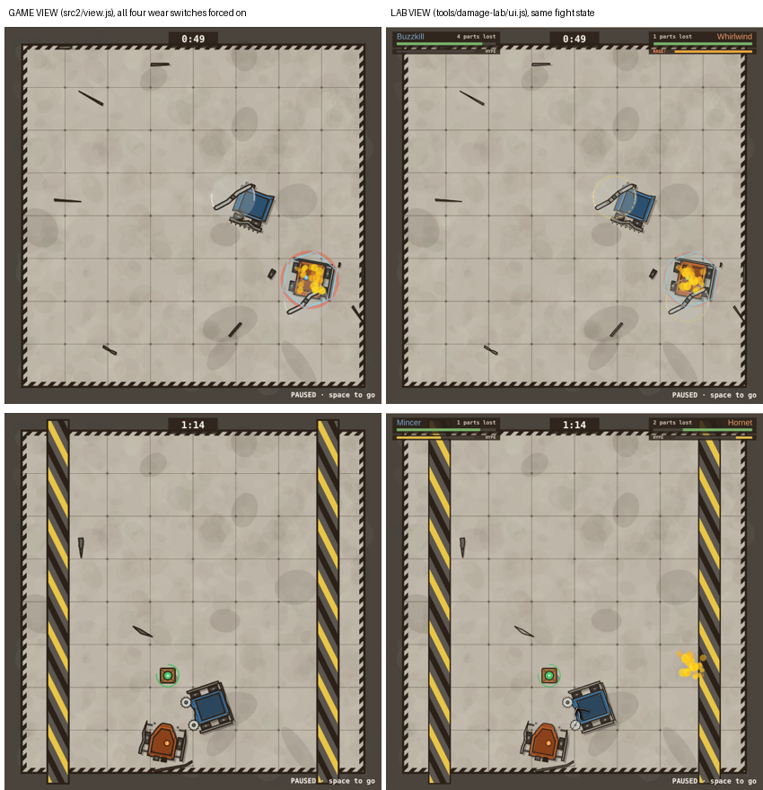

# ROBOCUS: wear on in the game (T41, 21 Nov 2026)

## Status (T41, kept up to date while the work goes on)

Kev (21 Nov): "bend as much as possible", then "no include all and do a rebalance", "keep bend until repair", "port them then".
Branch `claude/bending-on`.

- [x] Step 1, one switch: `ARC.cx` crack / frag / bend / grindout default **on** in `tools/damage-lab/engine.js` (the one place). A fight
  reads them once at `create()` into `S.wx`; its options can say `wear: false` (all off), `true`, or per effect. The game puts
  `wear: BAL.wear !== false` into every fight's options (`buildFight`, the odds overview), so the host, every joined screen (they build
  the fight from `F.bb`) and the bookie's workers (they get `bb`) agree. `BAL.wear = false` turns all four off. The bump switches
  (slide, under, crush, gut) stay off. Lab pages: the four wear boxes start ticked (were unticked). With all four off, the stock-fight
  fingerprint is bit-identical to `origin/main` (checked).
- [x] Step 1, drawing: the lab's wear layer is in `src2/view.js` (fold lines on bent plates and weapons, cracks incl. chassis cracks
  through the top plate, saw grooves glowing while the saw is in, the bent bar's two reach streaks and off-centre disc, warped
  buzzsaws / orbit discs / grinders / Grandmaster's saw, the shell out of round, Thumper's bent handle); records (Jukebox) now
  draw their warp too (new, in both `ui.js` and `view.js`).
- [x] Carry-over (Kev: "keep bend until repair"): `wearOf` keeps `marks` (per part label: shape, kinks, plate bends, cracks,
  grooves, warp, snapped pieces; numbers only), `applyWear` puts them back. `node tools/damage-lab/wear-carry.js` checks it.
  `src2/repair.js`: repairing a zone clears its marks; a zone with a mark the engine calls out (bent 10°+, warped, a plate in a
  wheel, sawn open, a tip broken off, a crack 10 cm+) was first counted as damaged; Kev then chose "only shown" (below); `markCost` prices marks.
- [x] Step 2, retune. Round 1 (`WEAR.hpExp` 0.5: a tougher robot's metal bends, cracks and saws less for the same blow, as weapons
  already resisted kinks by the square root of their health): Gaucho -15 → -5, Buzzkill +14 → +2, Thumper -14 → -7, Tarantula
  +12 → +7, Grandmaster +11 → +7; still out: Thwacker -24, Popcorn +20, Orbiter +15, Whaler +14, Hydra -13. Thwacker diagnosed
  (144 fights a variant): no single cause (without its tail kinking -21, without wheel rub -15, bending alone -10, cracks about -7):
  it fights long and wears down. Round 2: power dials for the 11 robots still off (`tools/damage-lab/lineup.js`, comment above
  ROBOTS). Result on 1,976 fights (T37's seeds, paired with the same fights without wear): **no robot outside its 95% range**,
  spread of the changes 5 points (= noise). Details in section "After" below.
- [x] Kev's PC run done (21 Nov): `tools\wear-tables.cmd` (see "The big run on Kev's PC" below). Waiting for its result file.
- [x] Step 3, tables: from Kev's big run (section "Step 3"): matchup table (`src2/matrix.js`), style tags, hard hitters, arena fits,
  FFA / 2v2 tags, great / poor fits and epics (plus a second round here, 462 x 2 fights). Bookie Brier 0.201 → **0.179** with the new table.
- [x] Kev (21 Nov, voting page): a mark alone is **not damage**: shown on the card ("BODY · CRACKED · fix?", grey), repairing it is
  optional (1 action, click the zone), it does not hold up Upkeep, the AI never repairs for it, robot value and repair costs see health
  only. The bookie still prices marks (they change the fight). Replaces the "big mark = damaged" choice above.
- [x] Final checks (21 Nov evening, rebased on origin/main 587508e, BUILD 2026-11-21k, files stamp **31ff00ca**): build.py; sync check
  89a95280 (unchanged); stock-fight fingerprint 470f6923 (unchanged since step 2: the tables do not change fights); game-sim 2/2, 0
  page errors; mp-test OK, desyncs 0 on every client, 12 fights checked, 12.3 min; fight-panels OK; robot-value OK (a marked zone
  at full health no longer lowers the value: Popcorn with a cracked Body is worth 1 Cr, as without the mark); questions-note OK (the
  first run under load 10-15 failed "last 5 s: not marked" on a countdown colour, the re-run alone passed); repair-note FAIL "9
  repairs: 8 buttons", the known failure that main has too. **Ready to merge.**
- [x] Step 4, checks (21 Nov, on this branch): build.py; stock-fight fingerprint (`l4-regress.js`) changes as it must:
  md5 of its output 0b8a0a7a… (origin/main) → 470f6923… (first line "Juggernaut v Brawler: 56.442 Juggernaut wins by KO" →
  "44.517 Juggernaut wins by KO"); with the four wear switches off it is bit-identical to origin/main (checked on the step-1 engine).
  Files stamp 352be701 → dbad9aea (changes again at the rebase/merge). Sync check: new reference 89a95280 (was 408e7f67): the engine
  changed and it now plays 25 fights (two with carried wear marks); node and Chromium give the same code. game-sim 2/2 finished,
  0 page errors. mp-test (2.0 page, 3 clients): OK, desyncs 0 on every client, 9 fights checked (marks carried online between them),
  3.4 min; after the rebase on origin/main (T35, T44, BUILD 2026-11-21k): game-sim 2/2, 0 page errors; mp-test OK, desyncs 0 on every
  client, 10 fights checked, 10.2 min. mp-scenario: fight-panels OK, repair-note-online OK; repair-note FAIL "9 repairs: 8 buttons" (Thumper's Weapon at 50% gets
  no button) — the same failure on origin/main (checked on a clean copy), so not from this branch. click-game.js 5 12: first run 2
  stuck steps (a joined seat's Intrigue turn with only ✕ to click: the known T30 flake), the re-run OK. Whole games: 40 + 40 (below).
  Screenshots (game fight view, 1600x900, plus 2x zooms): /home/claude/t41-shots/ (not in the repo).


## After (T41): wear on, retuned

All fights below: the game's 33 robots built as the game builds them, open floor, every pair at most one level apart, T37's seeds
(8 fights a pair, 1,976 fights), paired with T37's fights of the same robots, seeds and sides **without** wear. Wear means all four
switches on, as the game now plays. Raw results: `tools/damage-lab/wear-game/t41_round2_all.jsonl`, report `t41_round2_report.md`.

### Per robot: change in win rate against the same fights without wear (all its fights, 95% range)

| Lv | Robot | vs own level: before → now | vs a level up: before → now | T37 (wear, old rules) | round 1 (hpExp) | **now** | what changed for it |
|---|---|---|---|---|---|---|---|
| 0 | Buzzkill | 55 → 55 | 40 → 53 | +14 ± 12 | +2 ± 12 | **+5 ± 13** (104) | hpExp 0.5 |
| 0 | Forklift | 44 → 50 | 20 → 28 | +5 ± 11 | +0 ± 11 | **+7 ± 12** (104) | hpExp 0.5 |
| 0 | Hornet | 33 → 34 | 33 → 30 | +3 ± 12 | -2 ± 12 | **+0 ± 12** (104) | hpExp 0.5 |
| 0 | Mincer | 48 → 42 | 28 → 28 | -5 ± 10 | -4 ± 8 | **-4 ± 9** (104) | hpExp 0.5 |
| 0 | Popcorn | 41 → 42 | 8 → 15 | +18 ± 11 | +20 ± 11 | **+4 ± 10** (104) | hpExp 0.5; power 0.97 → 0.897 (-8%): its flipper barely bends while its rivals' weapons do |
| 0 | Scythe | 47 → 64 | 40 → 30 | -3 ± 12 | +3 ± 12 | **+7 ± 12** (104) | hpExp 0.5 |
| 0 | Snapjaw | 56 → 52 | 25 → 28 | +1 ± 12 | +0 ± 11 | **-2 ± 11** (104) | hpExp 0.5 |
| 0 | Thumper | 58 → 52 | 45 → 35 | -14 ± 12 | -7 ± 13 | **-8 ± 13** (104) | hpExp 0.5; power 0.882 → 0.905 (+3%): its axe handle wrenches, cracks |
| 0 | Wrecker | 69 → 59 | 20 → 30 | +4 ± 12 | +10 ± 12 | **-2 ± 12** (104) | hpExp 0.5; power 1.146 → 1.103 (-4%): its flail folds the most plates (6.4 a fight on rivals) |
| 1 | Blacksmith | 41 → 44 | 57 → 57 | -3 ± 8 | -3 ± 8 | **-3 ± 8** (144) | hpExp 0.5 |
| 1 | Corkscrew | 41 → 41 | 33 → 13 | -8 ± 9 | -10 ± 7 | **-5 ± 8** (144) | hpExp 0.5; power 0.753 → 0.781 (+4%): its drill kinks |
| 1 | Mauler | 41 → 47 | 33 → 20 | +6 ± 10 | +6 ± 9 | **+3 ± 9** (144) | hpExp 0.5 |
| 1 | Thwacker | 63 → 53 | 30 → 33 | -26 ± 10 | -24 ± 9 | **-6 ± 9** (144) | hpExp 0.5; power 2.898 → 3.159 (+9%): no single cause (tail kink, wheel rub, cracks each a part); it fights long and wears down |
| 1 | Vertigo | 66 → 66 | 30 → 35 | +3 ± 10 | -1 ± 9 | **-1 ± 9** (144) | hpExp 0.5 |
| 2 | Angler | 75 → 84 | 23 → 21 | +8 ± 9 | +4 ± 10 | **+5 ± 10** (120) | hpExp 0.5 |
| 2 | Gyro | 9 → 19 | 67 → 73 | +7 ± 9 | +10 ± 9 | **+3 ± 9** (120) | hpExp 0.5; power 1.084 → 1.043 (-4%): its shell knocks rivals' plates in (6.7 bends, 1.9 wheel rubs a fight on rivals) |
| 2 | Pincher | 50 → 56 | 29 → 23 | -10 ± 11 | +0 ± 10 | **-5 ± 10** (120) | hpExp 0.5 |
| 2 | Whaler | 72 → 66 | 29 → 25 | +9 ± 9 | +14 ± 10 | **+6 ± 9** (120) | hpExp 0.5; power 1.449 → 1.373 (-5%): it folds rivals' plates into their wheels |
| 2 | Yoyo | 44 → 25 | 31 → 17 | -8 ± 11 | -6 ± 12 | **-9 ± 12** (120) | hpExp 0.5 |
| 3 | Gaucho | 57 → 40 | 27 → 28 | -15 ± 10 | -5 ± 10 | **-6 ± 10** (144) | hpExp 0.5 |
| 3 | Grandmaster | 43 → 40 | 20 → 27 | +11 ± 9 | +7 ± 9 | **+5 ± 8** (144) | hpExp 0.5 |
| 3 | Hydra | 65 → 57 | 56 → 41 | -13 ± 10 | -13 ± 9 | **-6 ± 9** (144) | hpExp 0.5; power 1.501 → 1.575 (+5%): its arm segments kink and crack |
| 3 | Scavenger | 38 → 43 | 36 → 39 | -1 ± 9 | -8 ± 9 | **+3 ± 9** (144) | hpExp 0.5; power 1.723 → 1.775 (+3%): slightly down after round 1 |
| 3 | Slingshot | 63 → 65 | 50 → 38 | +5 ± 9 | -4 ± 9 | **-3 ± 10** (144) | hpExp 0.5 |
| 3 | Tarantula | 35 → 55 | 42 → 45 | +12 ± 10 | +7 ± 10 | **+8 ± 10** (144) | hpExp 0.5 |
| 4 | Bricklayer | 57 → 54 | - | -4 ± 12 | +1 ± 10 | **-6 ± 10** (104) | hpExp 0.5 |
| 4 | Jukebox | 55 → 59 | - | -6 ± 12 | -9 ± 13 | **-2 ± 12** (104) | hpExp 0.5; power 1.795 → 1.856 (+3%): its records warp, a warped saw cuts less |
| 4 | Lodestone | 41 → 29 | - | +4 ± 11 | +5 ± 11 | **+2 ± 11** (104) | hpExp 0.5 |
| 4 | Orbiter | 48 → 46 | - | +12 ± 10 | +15 ± 10 | **+3 ± 10** (104) | hpExp 0.5; power 2.305 → 2.176 (-6%): its discs only warp a little; it saws into rivals |
| 4 | Pogo | 57 → 63 | - | +3 ± 10 | +2 ± 9 | **+3 ± 9** (104) | hpExp 0.5 |
| 4 | Railgun | 59 → 63 | - | +5 ± 11 | +2 ± 12 | **+7 ± 11** (104) | hpExp 0.5 |
| 4 | Rotisserie | 48 → 50 | - | -6 ± 11 | -5 ± 10 | **-4 ± 10** (104) | hpExp 0.5 |
| 4 | Trebuchet | 34 → 38 | - | +4 ± 11 | +7 ± 12 | **+6 ± 12** (104) | hpExp 0.5 |

No robot is outside its 95% range now (with 33 robots, about 2 would be by luck); the changes spread 5 points, which is what
noise alone gives. Before the retune (T37) 10 robots were outside, spread 9. Per robot the numbers are good to about ±10.

### Level steps (how often the higher level wins; target 63-68%)


| Step | Fights | Today | B: all four | change |
|---|---|---|---|---|
| level 0 → 1 | 360 | 71% ± 5 | 69% | -2 ± 5 |
| level 1 → 2 | 200 | 64% ± 7 | 69% | +5 ± 8 |
| level 2 → 3 | 240 | 64% ± 6 | 68% | +4 ± 7 |
| level 3 → 4 | 384 | 61% ± 5 | 64% | +2 ± 6 |
| all steps | 1184 | 65% ± 3 | 67% | +2 ± 3 |

All within noise of the band; 0 → 1 and 1 → 2 are a point above it (± 5-8). The big run on Kev's PC (10,560 fights, every pair) checks this with three times the fights; a last small nudge can follow from it.

### Fight length, knockouts


| | Today (off) | B: all four |
|---|---|---|
| Fight length, s | 72.9 ± 1.4 | 72.4 ± 1.5 |
| Knockouts | 84% | 81% |
| Ends on time (judges) | 16% | 19% |
| No winner | 0 | 0 |
| Winner differs from today, B: all four |  | 32% |

### The bookie (matchup table of 15 Nov, measured without wear, against these results)


| Odds | Results | Brier | favourite wins | mean odds of the favourite |
|---|---|---|---|---|
| matchup table (game odds, robots as they come) | today (1976) | 0.182 | 75% ± 2 | 77% |
| matchup table (game odds, robots as they come) | B: all four (1976) | 0.201 | 70% ± 2 | 77% |
| level only (strength model) | today (1976) | 0.236 | 65% ± 3 | 65% |
| level only (strength model) | B: all four (1976) | 0.233 | 67% ± 3 | 65% |

Brier change, matchup table, B: all four: +0.019 ± 0.012 (paired).

With the old table the bookie is off by as much as in T37 (0.201 vs 0.182). The table must be measured again with wear on:
that is the big run on Kev's PC. Until then the game uses the old table (the test-fight bookie already sees wear).

### Buzzkill vs Whirlwind (Kev's fight), wear on as in the game now

24 fights (12 seeds, both sides): Buzzkill's bar bent 10°+ in 23 of 24 fights, Whirlwind's in 24 of 24; the most bent arm 25° /
27° on average (34° at most), 15° / 20° still bent at the end; a bar snapped in 7 / 5 fights. Buzzkill wins 38% (Whirlwind is
an old 2.0 robot at its own strength). Still clearly visible: the hpExp change does not touch weapon kinks.

### Marks that stay until repaired (Kev: "keep bend until repair")

- What stays (`wearOf` → `spec.wear.marks`, keyed by part label, numbers only): each part's outline if a kink, warp, split or snapped
  tip changed it; its straight shape; kinks; plate bends (and so the wheel it drags on); cracks; saw grooves (a chassis sawn open keeps
  its smoking wound); warps; Thumper's bent handle; a bent beak. `node tools/damage-lab/wear-carry.js 24`: every mark comes back
  exactly in the next fight, through JSON, and two fights built from the same options play the same.
- A repair of the zone a part belongs to (Weapon, Drive, Body: the game's own `zoneOfPart`) clears its marks with its health. The free
  Upkeep Body heal (to half) does not straighten anything.
- A zone with a mark the engine would call out (bent 10°+, warped, a plate in a wheel, sawn open, a tip broken off, cracks 10 cm+) is
  `marked`. Kev (21 Nov): "Only shown on the card: repairing it is optional and the AI ignores it". So `damaged` sees health only
  (repair costs, the repair note, the AI's repairs, the robot's value); the card shows the mark in grey ("⛨ BODY · CRACKED · fix?"),
  a click repairs that zone for 1 action, and the tooltip says it is optional and still changes the fight. A first version counted
  big marks as damage; the whole-game numbers below were measured with that version (marks then cost a repair action, now they don't).
- The bookie: test fights see the marks (they are in spec.wear). The formula prices them (`src2/repair.js` `markCost`), measured with
  `tools/damage-lab/markcost.js`: 66 damaged states out of real fights, each in 16 fights with and without its marks (1,056 fights
  each way): with marks the robot won 11.2%, without 11.6% (0.4 points, ± 2.6). Next to the health damage that comes with them, the
  marks cost little. Fitted and rounded (never below 0): a plate in a wheel 0.25 logits a wheel, a fully warped disc 0.25, a tip broken
  off 0.15, sawn open 0.2, cracks 0.08 a metre, a bend nothing measurable. Mean of the priced marks 0.08 logits against a measured
  0.03 ± 0.3: right on average, and per state no worse than pricing nothing (root mean square error 0.63 vs 0.65).
- Saves and online: the marks are part of `r.wear`, which is already in the game state. Old saves load (their robots have no marks).
  A robot's wear after a fight: 503 bytes without marks, 1,002 with (2,282 at most; 32 robots). The whole game state at the end of a
  game: 45.3 / 49.6 / 27.5 KB with marks, 41.3 / 44.0 / 27.2 KB without (3 games): about 10% more.
- `BAL.wearMarks = false` (test switch): marks are dropped after the fight, as before.

### Whole games with carry-over (40 AI games each way, same seeds 1-40, AI v2, this branch)

| | Marks stay until repaired | Marks dropped after a fight (`wearMarks: false`) |
|---|---|---|
| Games finished, page errors | 40 / 40, 0 | 40 / 40, 0 |
| Rounds a game | 11.5 | 11.9 |
| Repairs per team per round | 4.7 | 4.4 |
| Repairs by zone (drive / weapon / body) | 27 / 28 / 45% | 28 / 25 / 47% |
| Credits spent on repairs a game (all teams) | 39.5 | 41.1 |
| Credits held per team at Upkeep; at the end | 7.5; 9.2 | 7.6; 9.2 |
| Fighters sent with Drive / Weapon / Body damage | 7 / 8 / 27% | 7 / 6 / 29% |
| Bookie favourite wins; Brier | 74%; 0.177 | 72%; 0.179 |

Keeping the marks changes little in whole games: a few more Weapon repairs (28% of repairs instead of 25%) and slightly more robots
sent with a damaged weapon (8% vs 6%); credits and game length within noise (40 games: about ± 0.6 rounds, ± 2 points).

## Step 3: the tables from the big run on Kev's PC (21 Nov)

Kev ran `tools\wear-tables.cmd` (16 logical processors, 15 workers; result file made 15:22 UTC, no failed jobs). It ran revision
ef3b8e3 of this branch: since then nothing that plays a fight changed (`engine.js`, `lineup.js`, `dmath.js`, `matrix.js`,
`arenafit.js`, `tag-sim2.js`, `src2/repair.js` are identical; its `lineup.json` matches today's dials exactly; `WEAR.hpExp` 0.5). Only
the whole games ran on the page as it was then (before T35 / T44 came in from main; both are off by default or display only).
So the tables are current: no re-run needed. Raw data stays outside the repo; kept: `tools/damage-lab/wear-game/t41_bigrun_*`.

### Level steps from the big run (open floor, every pair, 20 fights a pair, seeds 7700+; "before" = the 15 Nov table, same seeds, no wear)

| step | fights | before (no wear) | now (wear, retuned) |
|---|---|---|---|
| 0 -> 1 | 900 | 69% ± 3 | 74% ± 3 |
| 1 -> 2 | 500 | 65% ± 4 | 70% ± 4 |
| 2 -> 3 | 600 | 70% ± 4 | 69% ± 4 |
| 3 -> 4 | 960 | 59% ± 3 | 63% ± 3 |
| 0 -> 2 | 900 | 86% ± 2 | 83% ± 2 |
| 1 -> 3 | 600 | 84% ± 3 | 75% ± 3 |
| 2 -> 4 | 800 | 85% ± 2 | 83% ± 3 |

Kev's question (0 → 1 and 1 → 2 were 69% on 1,976 fights): the big run **confirms they are steep**, and more clearly: 0 → 1 is
74% ± 3 (it was 69% ± 3 on this table before wear) and 1 → 2 70% ± 4 (65% before). 2 → 3 69% ± 4 and 3 → 4 63% ± 3 are at or just
outside the band. Not nudged (as asked); a nudge would be: level 0 robots up about 4-5% power, or level 1 down 3% and level 2 down 2%.

### Per robot (open floor, all fights against robots at most a level away; ± is 95%, unpaired: different fights)

| robot | lv | vs own level before → now (fights) | vs a level up before → now (fights) | change ± (fights) |
|---|---|---|---|---|
| Buzzkill | 0 | 50 -> 66 (160) | 29 -> 39 (100) | +13 ± 9 (260) **(outside)** |
| Forklift | 0 | 54 -> 57 (160) | 20 -> 22 (100) | +3 ± 8 (260) |
| Hornet | 0 | 43 -> 28 (160) | 45 -> 28 (100) | -16 ± 8 (260) **(outside)** |
| Mincer | 0 | 46 -> 43 (160) | 31 -> 20 (100) | -6 ± 8 (260) |
| Popcorn | 0 | 53 -> 43 (160) | 29 -> 23 (100) | -8 ± 8 (260) **(outside)** |
| Scythe | 0 | 53 -> 53 (160) | 31 -> 30 (100) | +0 ± 9 (260) |
| Snapjaw | 0 | 51 -> 49 (160) | 36 -> 27 (100) | -5 ± 8 (260) |
| Thumper | 0 | 41 -> 50 (160) | 40 -> 28 (100) | +1 ± 8 (260) |
| Wrecker | 0 | 61 -> 63 (160) | 20 -> 19 (100) | +1 ± 9 (260) |
| Blacksmith | 1 | 51 -> 48 (80) | 52 -> 49 (100) | +2 ± 7 (360) |
| Corkscrew | 1 | 43 -> 40 (80) | 28 -> 11 (100) | -4 ± 7 (360) |
| Mauler | 1 | 45 -> 48 (80) | 25 -> 14 (100) | +1 ± 7 (360) |
| Thwacker | 1 | 58 -> 55 (80) | 26 -> 37 (100) | +9 ± 7 (360) **(outside)** |
| Vertigo | 1 | 54 -> 60 (80) | 43 -> 39 (100) | -2 ± 7 (360) |
| Angler | 2 | 59 -> 70 (80) | 14 -> 22 (120) | +10 ± 8 (300) **(outside)** |
| Gyro | 2 | 9 -> 23 (80) | 56 -> 64 (120) | +7 ± 8 (300) |
| Pincher | 2 | 41 -> 39 (80) | 28 -> 25 (120) | -6 ± 8 (300) |
| Whaler | 2 | 75 -> 70 (80) | 28 -> 26 (120) | +8 ± 8 (300) |
| Yoyo | 2 | 66 -> 49 (80) | 24 -> 18 (120) | -8 ± 8 (300) **(outside)** |
| Gaucho | 3 | 48 -> 36 (100) | 32 -> 26 (160) | -8 ± 7 (360) **(outside)** |
| Grandmaster | 3 | 46 -> 40 (100) | 29 -> 27 (160) | +1 ± 7 (360) |
| Hydra | 3 | 66 -> 64 (100) | 55 -> 47 (160) | -9 ± 7 (360) **(outside)** |
| Scavenger | 3 | 21 -> 29 (100) | 42 -> 34 (160) | +1 ± 7 (360) |
| Slingshot | 3 | 62 -> 68 (100) | 51 -> 46 (160) | -2 ± 7 (360) |
| Tarantula | 3 | 57 -> 63 (100) | 34 -> 42 (160) | +5 ± 7 (360) |
| Bricklayer | 4 | 66 -> 59 (140) | - | -2 ± 8 (260) |
| Jukebox | 4 | 44 -> 53 (140) | - | +10 ± 9 (260) **(outside)** |
| Lodestone | 4 | 37 -> 30 (140) | - | -1 ± 8 (260) |
| Orbiter | 4 | 54 -> 52 (140) | - | +2 ± 8 (260) |
| Pogo | 4 | 64 -> 63 (140) | - | -2 ± 8 (260) |
| Railgun | 4 | 49 -> 62 (140) | - | +9 ± 9 (260) **(outside)** |
| Rotisserie | 4 | 49 -> 44 (140) | - | -7 ± 9 (260) |
| Trebuchet | 4 | 37 -> 37 (140) | - | +4 ± 9 (260) |

11 of 33 robots are outside their range (about 2 by luck), but only two are more than about 10 points off: **Hornet −16 ± 8** and
**Buzzkill +13 ± 9** (both level 0; the 1,976-fight run had them at +0 and +5). Then Angler +10, Jukebox +10, Thwacker +9, Railgun +9.
Question for Kev: nudge Hornet up and Buzzkill down (about 6-8% power each) together with the level 0 → 1 step?

### The bookie

| Odds | Results | Brier | favourite wins |
|---|---|---|---|
| 15 Nov table (no wear) | the same 1,976 fights without wear | 0.182 | 75% |
| 15 Nov table (no wear) | the retuned fights with wear (t41_round2_all) | 0.201 | 70% |
| **new table (big run, wear)** | **the retuned fights with wear** | **0.179** | **75%** |

Paired against the old table on the no-wear fights: −0.008 ± 0.013. **The bookie is back** (within noise of 0.182). Whole games:
see the table below.

### Whole games with the new table (AI v2, same seeds 1-40 as the carry-over check)

| | 15 Nov table (40 games here) | new table (37 + 3 games here) | Kev's 120 games (15 Nov table, his PC) |
|---|---|---|---|
| Bookie favourite wins | 74% | 77% | 75% |
| Bookie Brier (coin 0.25) | 0.177 | **0.164** | 0.170 |
| Rounds a game | 11.5 | 11.7 | 11.6 |

Three of the 40 games here stalled in round 1 with the box overloaded (load 12-16); run alone, all three finished (the same thing was
seen on 15 Nov). Kev's run: 119 of 120 finished (1 stall), 0 page errors.

### What moved for players (bookie tags and odds)

| Tag | Gone | New | Stays |
|---|---|---|---|
| 🎯 Counter pick / Bad matchup (from the table, 40+ points off the level gap) | 11 (e.g. Mincer vs Mauler, Popcorn vs Blacksmith, Snapjaw and Blacksmith vs Thwacker, Hydra vs Tarantula) | 18 (e.g. Buzzkill vs Hornet, Wrecker vs Hornet and Popcorn, Blacksmith vs Mauler and Tarantula, Gyro vs Slingshot and Railgun, Thwacker vs Pincher) | 32 (43 → 50 in all) |
| ⚡ Epic combo | Haywire (Popcorn + Sensor scrambler: 17 → 33%, not even a great fit now) | - | Whiplash 30 → 78%, Phantom Hook 28 → 83%, Overclock 50 → 80%, Iron Bolas 12 → 58% |
| 🧩 Great fit | Corkscrew + Field hospital (just under the cut), Popcorn + Sensor scrambler | Thwacker + Pester chip (27-30 → 57-70%, both rounds), Snapjaw + Wall Bait chip, Popcorn + Quantum shield, Wrecker + Jammer drone | Thwacker + Mine layer / Tow cable, Wrecker + Pester chip, Angler + Quantum, Vertigo + Power kit, Gaucho + Overdrive |
| 🧩 Poor fit | Forklift + Laser drone | Vertigo + Overdrive, Rotisserie + Overdrive, Corkscrew + Pester, Slingshot + Wall Bait, Hornet + Booster drone, Forklift + Pester | Rotisserie + Pester, Yoyo + Blocker drone |
| 🌀 Brawl master / Lost in a melee (750 FFAs, cut 14) | Rotisserie, Pogo, Trebuchet, Slingshot, Corkscrew | Angler +18, Railgun +23, Mincer −16, Pincher −16 | Jukebox +20, Orbiter +24, Gyro +14; Thwacker flips +14 → −18 |
| 🤝 Lone wolf / Team player (750 2v2) | - | - | none (Snapjaw −12, Angler +12 under the cut) |
| Style (Giant killer / Coin-flip / Quick / Grinder) | Lodestone coin-flip | Tarantula giant killer, Corkscrew, Angler, Trebuchet coin-flip, Yoyo grinder | 19 others (now from the 10,560 matchup fights, was 6,336 tag fights) |
| 🔨 Hard hitter | - | Jukebox, Orbiter | Gaucho, Buzzkill |
| Arena tags (fit 0.4+) | Thwacker hates ice (−1.23 → −0.22), Popcorn saw specialist, Corkscrew cage fighter and ice skater, Mauler and Vertigo ice, Whaler hates the Cage, Vertigo hates saws, Thwacker saws, Mincer hates ice, Yoyo hates saws, Pincher, Slingshot (cage, saws), Lodestone saws | Hornet hates the Cage, Mincer, Angler, Grandmaster hate saws, Wrecker saw specialist, Jukebox cage fighter | the rest; ice and killbox fits are smaller now (their noise shrink fits at 0.4 and 0.35, was 0.75 and 0.45) |

(22 Nov, T65: the epic, great / poor fit and giant-slayer rows are superseded by Kev's combo hunt: `docs/robocus-combo-hunt.md`.)

Not re-measured: the 👑 Giant-slayer builds (no slayer section in the run) and the part levels `PART_LV`. The big run's parts
section built robots the way the 15 Nov tag tool did (no level growth for drones and modules), so its levels for drones and modules
are not comparable; for stat parts and legendaries they stay within about ±0.3 of a level except **Overdrive: 0.80 → 1.28 levels**
(wear makes extra weapon damage worth more). PART_LV is unchanged; a `parttest.js` run would settle Overdrive (question for Kev).

## The big run on Kev's PC (T41)

Kev: "let me know if you want a big one to run on my pc". **Double-click `tools\wear-tables.cmd`.** It does not touch the ROBOCUS
folder: it clones the branch `claude/bending-on` into `%USERPROFILE%\robocus-wear` (or updates that clone), installs planck and
Playwright's Chromium there once, and runs `tools/damage-lab/wear-tables.js` on **15 workers** (16 logical processors, one left
for Windows). Close the window to stop; double-click again to go on (finished jobs are kept). Progress and the time left are on
one line. At the end it prints one file to send back: `%USERPROFILE%\robocus-wear\wear-results\wear-tables-results.json.gz`.

What it runs (all with wear on and the retuned robots): the open-floor matchup table (528 pairs x 20 = 10,560 fights), the four
arena tables (4 x 99 pairs x 20 = 7,920), arena fits (5 floors x 16 seeds = 15,840), every part on every robot vs a level up
(14,784), the 58 fit / epic candidates with and without the part (2 x 5,248), 750 free-for-alls and 750 2v2, then 120 whole AI
games of the game page (carry-over on). About 77,000 fights. Time: here one duel takes about 1.2 s of one core; a 9800X3D core is
about twice as fast and 15 workers on 8 cores / 16 threads give about 11 cores' worth, so **about 70 minutes of fights plus about
15 minutes of whole games: about 1.5 hours** (on an 8-thread PC with 7 workers, about 3 hours).

Note for the orchestrator: Kev's folder is on `main`, which does not have the .cmd yet. It is self-contained: copy it to his
folder (or let him download it from the branch on GitHub) and double-click it anywhere.

After it comes back: unpack (`node -e` gunzip, `files` map), `matrix-merge.js <dir>` → matrix-data.json → `build.py` (src2/matrix.js);
`style-tags.js <dir>` → STYLE / HITTER in tabletop-2.html; `arenafit-report.js <dir> --eb` → ARENA_FIT; `tag-tuned-report.py` /
`tag-tuned-final.py` with OUT=<tags dir> LINEUP=wear-results/lineup.json → fits, epics, FFA_FIT, 2v2 tags; parttest-style
levels from the parts section → PART_LV if a part moved; `game-sim-report.js` on the games.

---

# Before: bending and wear in real fights, measured (T37, 21 Nov 2026)

Kev (21 Nov): "I saw a fight between buzzkil and whirlwind and his blades didn't even really bend at any point. Did we forget to include this? at one point we had this". Then, to "measure first": "yes do this first step".

**Short answer.** Nothing was lost. The 11 Nov wear effects (`ARC.cx.crack`, `frag`, `bend`, `grindout`, see `contact-lab.md`, "Wear") are still in the engine, but they are **off by default** and the game never switches them on. In the Damage Lab they are tick boxes, unticked when the page opens. So a Buzzkill vs Whirlwind fight shows no bending unless "Bending" is ticked. (Whirlwind is not in the game's 33-robot lineup any more, so that fight was in the Damage Lab, or an older copy.)

This page measures what switching them on would do to the game. **Nothing is switched on.** The game, the lineup and the bookie are unchanged.

## How it was measured

- Tool: `tools/damage-lab/wear-game.js` (new), report `tools/damage-lab/wear-game-report.js` (new). Raw results in `tools/damage-lab/wear-game/`, the full report in `tools/damage-lab/wear-game/report.md`.
- The game's 33 robots, built the way the game builds them (`lineup.js` `build`, game part strengths), no parts, open floor.
- Every pair of robots at most one level apart (247 pairs), **8 fights a pair** (4 seeds x 2 sides). That gives each robot 32-64 fights against its own level and 40-64 against a level up.
- Each fight is played **three times on the same seed and sides**: today (all off), **A: bend only**, **B: crack + frag + bend + grindout**. The bump switches (slide, under, crush, gut) stay off.
- **1,976 matchups x 3 = 5,928 fights**, plus 24 Buzzkill vs Whirlwind fights x 3. About 1 h 35 min on this box (2 slow cores, shared with another worker).
- Changes are paired (the same fight with and without), with a 95% range (±). Note: a change of any kind sends a fight down another path, so about **a third of all winners flip either way** (31% for A, 34% for B). What matters is whether a robot's flips add up to a net gain or loss; the ± says how sure that is.

## 1. Win rate per robot

Win % against its own level and against a level up: today → A / B. The last two columns are the change over all its fights (own level, a level up and a level down), with the 95% range. **Bold**: outside its range.

| Lv | Robot | vs own level: today → A / B | vs a level up: today → A / B | all fights: A | all fights: B |
|---|---|---|---|---|---|
| 0 | Buzzkill | 55 → 59 / 67 | 40 → 40 / 57 | +3 ± 12 | **+14 ± 12** |
| 0 | Forklift | 44 → 48 / 52 | 20 → 20 / 20 | +3 ± 11 | +5 ± 11 |
| 0 | Hornet | 33 → 42 / 38 | 33 → 33 / 33 | +6 ± 13 | +3 ± 12 |
| 0 | Mincer | 48 → 41 / 41 | 28 → 20 / 28 | -8 ± 10 | -5 ± 10 |
| 0 | Popcorn | 41 → 50 / 47 | 8 → 40 / 45 | **+18 ± 11** | **+18 ± 11** |
| 0 | Scythe | 47 → 53 / 55 | 40 → 35 / 20 | +2 ± 11 | -3 ± 12 |
| 0 | Snapjaw | 56 → 55 / 48 | 25 → 23 / 40 | -2 ± 10 | +1 ± 12 |
| 0 | Thumper | 58 → 41 / 41 | 45 → 50 / 35 | -9 ± 13 | **-14 ± 12** |
| 0 | Wrecker | 69 → 61 / 63 | 20 → 48 / 40 | +6 ± 13 | +4 ± 12 |
| 1 | Blacksmith | 41 → 38 / 50 | 57 → 43 / 53 | **-12 ± 9** | -3 ± 8 |
| 1 | Corkscrew | 41 → 47 / 44 | 33 → 10 / 8 | -5 ± 8 | -8 ± 9 |
| 1 | Mauler | 41 → 75 / 53 | 33 → 28 / 28 | **+11 ± 9** | +6 ± 10 |
| 1 | Thwacker | 63 → 28 / 22 | 30 → 23 / 18 | **-23 ± 10** | **-26 ± 10** |
| 1 | Vertigo | 66 → 63 / 81 | 30 → 38 / 35 | +3 ± 10 | +3 ± 10 |
| 2 | Angler | 75 → 75 / 91 | 23 → 31 / 23 | +8 ± 10 | +8 ± 9 |
| 2 | Gyro | 9 → 22 / 25 | 67 → 81 / 71 | +8 ± 9 | +7 ± 9 |
| 2 | Pincher | 50 → 47 / 38 | 29 → 35 / 27 | -3 ± 9 | -10 ± 11 |
| 2 | Whaler | 72 → 72 / 69 | 29 → 38 / 27 | **+17 ± 10** | **+9 ± 9** |
| 2 | Yoyo | 44 → 34 / 28 | 31 → 17 / 10 | -7 ± 11 | -8 ± 11 |
| 3 | Gaucho | 57 → 35 / 35 | 27 → 27 / 20 | **-12 ± 10** | **-15 ± 10** |
| 3 | Grandmaster | 43 → 60 / 43 | 20 → 27 / 31 | **+10 ± 7** | **+11 ± 9** |
| 3 | Hydra | 65 → 65 / 55 | 56 → 44 / 33 | -5 ± 9 | **-13 ± 10** |
| 3 | Scavenger | 38 → 35 / 30 | 36 → 41 / 38 | -1 ± 9 | -1 ± 9 |
| 3 | Slingshot | 63 → 55 / 73 | 50 → 48 / 47 | -3 ± 7 | +5 ± 9 |
| 3 | Tarantula | 35 → 50 / 65 | 42 → 38 / 44 | -1 ± 10 | **+12 ± 10** |
| 4 | Bricklayer | 57 → 55 / 54 | - | -7 ± 10 | -4 ± 12 |
| 4 | Jukebox | 55 → 45 / 48 | - | **-13 ± 12** | -6 ± 12 |
| 4 | Lodestone | 41 → 38 / 36 | - | +0 ± 9 | +4 ± 11 |
| 4 | Orbiter | 48 → 57 / 55 | - | **+11 ± 9** | **+12 ± 10** |
| 4 | Pogo | 57 → 64 / 59 | - | +5 ± 7 | +3 ± 10 |
| 4 | Railgun | 59 → 52 / 61 | - | -1 ± 9 | +5 ± 11 |
| 4 | Rotisserie | 48 → 50 / 50 | - | +6 ± 8 | -6 ± 11 |
| 4 | Trebuchet | 34 → 39 / 38 | - | +4 ± 9 | +4 ± 11 |

(The "today" numbers per robot rest on 32-64 fights, so they are good to about ±15; the tuning used far more fights. Level 4 has no level up.)

- **A (bend only):** 9 robots move outside their range (luck alone would give about 2). The changes spread about 9 points either way, where noise alone gives about 5.
- **B (all four):** 10 robots move outside their range, same spread (9 points).

## 2. The level steps

How often the higher level wins, per step (today's target: about 63-68%).

| Step | Fights | Today | A: bend only | change | B: all four | change |
|---|---|---|---|---|---|---|
| level 0 → 1 | 360 | 71% ± 5 | 66% | -6 ± 6 | 65% | -7 ± 6 |
| level 1 → 2 | 200 | 64% ± 7 | 72% | +9 ± 8 | 72% | +9 ± 8 |
| level 2 → 3 | 240 | 64% ± 6 | 60% | -5 ± 7 | 68% | +4 ± 7 |
| level 3 → 4 | 384 | 61% ± 5 | 63% | +1 ± 5 | 65% | +3 ± 6 |
| all steps | 1,184 | 65% ± 3 | 65% | -1 ± 3 | 67% | +1 ± 3 |

**The levels hold on average.** The step from level 1 to 2 gets steeper (+9) and the step from 0 to 1 softer (-6), mostly because one level 1 robot, Thwacker, gets much weaker. No step leaves the 60-72% band.

## 3. Fight length, knockouts, time-outs

| | Today | A: bend only | B: all four |
|---|---|---|---|
| Fight length | 72.9 ± 1.4 s | 76.1 ± 1.5 s | 71.9 ± 1.5 s |
| Knockouts | 84% | 80% | 82% |
| Ends on time (judges) | 16% | 20% | 18% |
| Winner differs from today (same seed) | | 31% | 34% |

Bending alone makes fights a little longer (+3 s) and gives a few more judges' decisions: bent weapons hit less cleanly. With cracks on as well, the extra damage on cracked parts brings the length back.

## 4. Who gains and who loses most, and why

From the wear events counted on each robot and on its rivals (per fight, in the full report):

| Robot | A | B | Why (one line) |
|---|---|---|---|
| Thwacker (L1) | -23 | -26 | Its long thin tail kinks easily (the engine counts it as one of the most slender beams) and the most plates bend into its wheels (5.6 plate bends, 1 wheel rub a fight): the swing misses. Loses most to Vertigo, Mauler, Popcorn. |
| Gaucho (L3) | -12 | -15 | Its own side plates bend into its wheels (1.1 wheel rubs a fight, its rivals 0.1). |
| Hydra (L3) | -5 | -13 | With cracks: its arm segments crack and break up (2.6 cracks, 2.1 fragments a fight) and saws cut into it. |
| Thumper (L0) | -9 | -14 | Its axe handle wrenches (blows land off to the side), and with cracks it takes the most cracks of the starters (3.1 a fight). |
| Jukebox (L4) | -13 | -6 | Its record warps (0.7 warps a fight): a warped saw cuts less. |
| Blacksmith (L1) | -12 | -3 | Its plates bend into its wheels (4 plate bends, 1 rub a fight). |
| Popcorn (L0) | +18 | +18 | A flipper only bows a little, while its rivals' weapons bend (Hornet's spear points off, Thwacker's tail kinks). Against level 1: 8% → 40%. |
| Whaler (L2) | +17 | +9 | It bends its rivals' plates into their wheels (1.3 rubs a fight on its rivals); best against Mauler and Blacksmith. |
| Mauler (L1) | +11 | +6 | Its flail bends the most plates of anyone (6.8 a fight on its rivals, 1.6 wheel rubs). |
| Grandmaster (L3) | +10 | +11 | Its own weapons barely give (the axe head doesn't bend, the saw warps 0.1 times a fight), while its rivals' do. |
| Orbiter (L4) | +11 | +12 | Discs only warp a little; with grooves on, it saws through rivals (1.3 cuts a fight). |
| Buzzkill (L0) | +3 | +14 | With cracks: its spinner starts cracks (4.4 a fight on its rivals) and a cracked part takes up to 1.8x damage. Its own bar bends too, which costs it about as much as it gains in A. |
| Tarantula (L3) | -1 | +12 | With cracks: its fangs pierce (4.9 cracks a fight on its rivals, 2.1 run into their insides). |

In short: **bending hurts long thin weapons and robots whose side plates fold into their wheels; it helps blunt hitters that fold other robots' plates. Cracks add a bonus for piercing weapons (spinners, fangs).**

## 5. The bookie

The game's odds for robots as they come are the matchup table (`src2/matrix.js`, 20 fights a pair, measured with everything off). Checked against each variant's results (all 1,976 matchups):

| Odds | Results | Brier (lower is better) | favourite wins |
|---|---|---|---|
| Matchup table (the game's odds) | today | 0.182 | 75% ± 2 |
| | A: bend only | 0.204 | 69% ± 2 |
| | B: all four | 0.200 | 70% ± 2 |
| Level only (no matchup table) | today | 0.236 | 65% ± 3 |
| | A / B | 0.237 / 0.234 | 65% / 67% |

Paired change in Brier for the matchup table: **A +0.023 ± 0.012, B +0.018 ± 0.012**. The bookie would still be far better than levels alone, but it would lose about half of what the matchup table adds over levels: the favourite would win 69-70% instead of 75% while the odds still say 77%. **The matchup table, the counter tags and the arena tables would have to be measured again.**

## 6. Buzzkill vs Whirlwind

24 fights a variant (12 seeds, both sides). Whirlwind is the old 2.0 robot (not in the game's lineup), at its own preset strength.

| Variant | Buzzkill wins | Robot | bar bent 10°+ at some point | most bent arm (mean / max) | still bent at the end (mean) | bar snapped |
|---|---|---|---|---|---|---|
| Today | 21% ± 17 | Buzzkill | 0 of 24 | 0° | 0° | 0 |
| | | Whirlwind | 0 of 24 | 0° | 0° | 0 |
| A: bend only | 25% ± 18 | Buzzkill | 23 of 24 | 26° / 34° | 15° | 8 of 24 |
| | | Whirlwind | 24 of 24 | 28° / 34° | 15° | 11 of 24 |
| B: all four | 33% ± 19 | Buzzkill | 24 of 24 | 25° / 34° | 18° | 5 of 24 |
| | | Whirlwind | 24 of 24 | 28° / 34° | 17° | 9 of 24 |

Per fight, bend only (most bent arm, Buzzkill / Whirlwind): 23/29, 7/22, 33/33, 33/33, 33/28, 31/26, 34/31, 17/31, 32/24, 17/30, 26/24, 25/33, 25/33, 29/32, 34/34, 28/23, 30/31, 17/31, 27/26, 17/30, 26/20, 21/16, 33/33, 22/33.

With bending on, **both bars bend in practically every fight**, 20-34° (34° is the most the engine allows), and in about 4 fights out of 10 a bar bends so far that its tip snaps off. Today they never bend, because the switch is off.

## 7. What the game's fight view would draw



Top: Buzzkill vs Whirlwind at 70 s, both bars bent 14-25°. Bottom: Mincer vs Hornet at 45 s, cracks, plate bends, grooves and warped grinders. Made with a scratch page (not committed) that forces the switches on and hands the same fight state to `src2/view.js` and to the lab renderer.

The game's view (`src2/view.js`) is an older copy of the lab renderer (`tools/damage-lab/ui.js`) without its wear layer. Read from the code and seen in the pictures:

| Wear mark | Game view today | Lab view |
|---|---|---|
| Bent weapon (kink) | **The bent shape shows** (it draws each part's outline, and the outline is bent) | the shape, plus a fold line across the beam and scuffed paint |
| Spinning bent bar | one plain blur | each arm's own reach streak, the swept disc off centre, a dashed amber ring for the shorter arm |
| Bent plate | the dented outline shows | plus fold lines |
| Crack | **nothing** | dark crack lines on the part; chassis cracks show through the top plate |
| Fragments, snapped tips | **show** (they are ordinary debris pieces) | the same |
| Saw groove | only the notch in the outline, no colour | bright cut metal, glowing while the saw is in it |
| Warped disc (taco) | **nothing** (discs and saws are drawn as circles) | fold line, out-of-round disc, dashed ring |
| Callouts and feed lines ("BENT!", "SNAPPED!", "Buzzkill: spinner bar bent 23°, it wobbles") | **show** (generic) | the same |

To show wear properly in the game, `drawWear`, the bent-bar spin marks, the warp marks and the chassis cracks (about 60 lines) would be copied from `ui.js` into `view.js`.

## 8. Does wear carry to the next fight?

**No. A bent blade comes back straight.** Checked in code and with a test (`node tools/damage-lab/wear-game.js carry`): the game keeps damage with `wearOf` / `spec.wear` (part health, lost parts, insides, top plate, drones, dents on the robot's own body). It does not store kinks, plate bends, cracks, grooves or warps. So next fight:

- a bent or warped weapon is straight again, but keeps its lower health;
- a bar whose tip snapped comes back whole (the tip is not a part the game knows), with the health it had;
- a plate that fragmented or fell off stays lost (as today);
- a cracked part loses its crack and the extra damage it takes.

Carrying bends would need `wearOf` / `applyWear` to store them, the save and online messages to carry them, and a rule for which repair straightens them (Weapon repair, likely). That is an engine change, and the bookie's damage pricing (`repair.js` wear costs) would need a new measure.

## Options for Kev

| Option | What players see | Rework it costs |
|---|---|---|
| **1. Keep off** (today) | No bends in the game. Bends stay in the Damage Lab (tick "Bending"). | None. |
| **2. Bend only, as it is** | Bars, spears, tails and forks kink in most fights; plates fold into wheels. | Retune about 9 robots (Thwacker -23, Jukebox -13, Blacksmith -12, Gaucho -12; Popcorn +18, Whaler +17, Mauler +11, Orbiter +11, Grandmaster +10): two or three tuning rounds. Re-measure the matchup table and arena tables (about 18,000 fights) and the counter tags (about 10,000). Copy the lab's wear drawing into `view.js` (small). Optional: carry bends between fights (engine + save + online). |
| **3. All four, with a retune** | As 2, plus cracks, fragments and saw grooves; the most violent look. | The same as 2 with a slightly different list (Thwacker -26, Gaucho -15, Thumper -14, Hydra -13; Popcorn +18, Buzzkill +14, Orbiter, Tarantula +12, Grandmaster +11, Whaler +9). The crack drawing is the most work in `view.js`. |
| **4. Bending on spinner bars only** (what Kev noticed) | spinner bars (Buzzkill) kink; nothing else changes. | Needs a small new engine switch (bend only for `blade`), then the same measure as here (about 1.5 h here, minutes on Kev's PC). Likely far fewer robots move, so likely no retune. Not measured yet. |

Multiplayer: the switches are global engine settings, so all screens must use the same ones (set from the game's build, not a menu). Fights stay deterministic either way.

## A fuller run on Kev's PC

Here: 8 fights a pair (104-144 fights a robot per variant). For about ±7 per robot instead of ±10, run 24 fights a pair (17,800 fights; on an 8-core PC roughly 20-40 minutes). From the ROBOCUS folder, in a command window:

```
cd tools\damage-lab
set K=24
for /L %i in (0,1,7) do start "wear %i" /min node wear-game.js duel wear-game\pc_%i.jsonl %i 8
```

When the eight windows have closed (it resumes if stopped; run the same line again):

```
set N=48
node wear-game.js bw wear-game\bw_pc.jsonl
node wear-game-report.js wear-game\pc_*.jsonl --bw wear-game\bw_pc.jsonl > wear-game\report-pc.md
```

## Side finding

The **Lineup Arena** and **Contact Lab** pages (`prototypes/lineup-arena.html`, `contact-lab.html`) stop with a script error when they open: their fourth robot card starts as Juggernaut, which is no longer in the lineup (`tools/damage-lab/ui.js`, `st.spec`). The Damage Lab opens fine. A one-word fix in `ui.js` plus a rebuild; not done here (outside this task).
